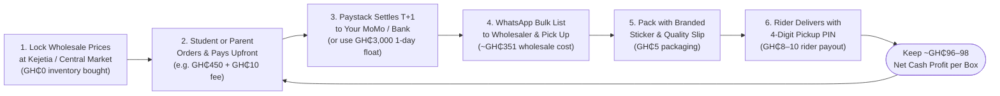
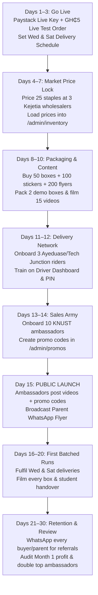
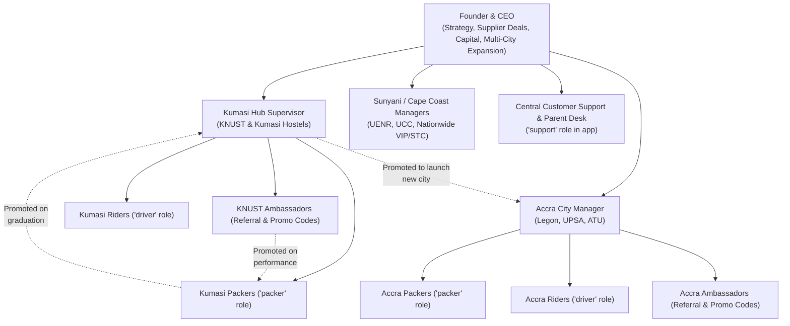

# Food Bundle — Growth & Hiring Roadmap (Flowchart Edition)

## 1. Master Growth & Hiring Flowchart (From Solo Founder to 100+ Employees)

```mermaid
flowchart TD
  Start(["START: Solo Founder in Kumasi<br/>Capital: Under GH₵5,000<br/>Platform: Built & Live"]) --> S1A

  subgraph Stage1["STAGE 1: Launch Prep (Weeks 1–2) · Team: 1 (You)"]
    S1A["Days 1–3: Switch Paystack to Live Mode<br/>Run GH₵5 live Student & Guest test order"] --> S1B["Days 4–7: Kejetia / Central Market Walk<br/>Lock in wholesale prices for 25 core items<br/>Enter prices into /admin/inventory"]
    S1B --> S1C["Days 8–10: Buy 50 cartons + print 100 brand stickers<br/>Pack 2 demo boxes & film 15 unboxing videos"]
    S1C --> S1D["Days 11–14: Recruit 3 on-call riders (GH₵8–12/drop)<br/>Recruit 10 KNUST ambassadors (GH₵15–20/order)<br/>Issue promo codes in /admin/promos"]
  end

  S1D --> S2A

  subgraph Stage2["STAGE 2: First 50 Orders at KNUST (Months 1–2) · Team: 1 + Commission Network"]
    S2A["Launch at KNUST & Hostels<br/>(Main Campus, Ayeduase, Gaza, Brunei, Kotei, Bomso)"] --> S2B["Ambassadors post unboxing videos + promo codes<br/>Students forward Parent Flyer on WhatsApp"]
    S2B --> S2C["Batch orders into Wed & Sat delivery runs<br/>Run Cash-Before-Stock T+1 Loop (~GH₵98 margin/box)"]
    S2C --> Gate1{"Weekly Volume >= 25 Bundles?<br/>(~GH₵2,450/wk gross margin)"}
  end

  Gate1 -- "No: Keep hustling &<br/>adding ambassadors" --> S2B
  Gate1 -- "Yes: Hire #1" --> S3A

  subgraph Stage3["STAGE 3: First Hires & Formalization (Months 3–6) · Team: 3–5"]
    S3A["HIRE #1: 2 Part-Time Student Packers<br/>(GH₵4/box · Assign 'packer' role in app)"] --> S3B["Rent small packing/storage room near KNUST<br/>Register company with ORC & open business bank/MoMo"]
    S3B --> Gate2{"Weekly Volume >= 40 Bundles?<br/>(~GH₵3,900/wk gross margin)"}
    Gate2 -- "Yes: Hire #2" --> S3C["HIRE #2: Lead Campus Rider<br/>(Assign 'driver' role · Coordinates Wed/Sat drops)"]
    S3C --> Gate3{"Weekly Volume >= 60 Bundles?<br/>(~GH₵5,880/wk gross margin)"}
    Gate3 -- "Yes: Hire #3" --> S3D["HIRE #3: Part-Time Support & WhatsApp Closer<br/>(Assign 'support' role · Closes parent & guest orders)"]
  end

  S3D --> S4A

  subgraph Stage4["STAGE 4: Capital Raise & Supplier Credit (Months 6–12) · Team: 8–12"]
    S4A["Build Investor Data Room<br/>(6 months of Paystack exports + wholesale receipts)"] --> S4B["Negotiate 7–14 Day Wholesale Credit at Kejetia/Asafo<br/>Pitch KIC, Kumasi Hive, TEF, MEST & Angels for GH₵350k"]
    S4B --> Gate4{"Weekly Volume >= 120 Bundles?<br/>(~GH₵11,760/wk gross margin)"}
    Gate4 -- "Yes: Hire #4" --> S4C["HIRE #4: Full-Time Kumasi Operations Supervisor<br/>(Assign 'admin' role · Runs daily Kumasi hub)"]
  end

  S4C --> S5A

  subgraph Stage5["STAGE 5: Multi-City Expansion (Year 2) · Team: 25–40 Across 3 Cities"]
    S5A["Activate Accra (Legon / UPSA / ATU)<br/>& Sunyani (UENR) delivery zones"] --> S5B["Hire City Operations Coordinator per city<br/>Open Madina & Sunyani micro-packing hubs"]
    S5B --> S5C["Scale VIP / STC nationwide parcel station delivery<br/>Open direct FMCG distributor accounts (Nestle, Wilmar, Olam)"]
    S5C --> Gate5{"Annual Volume >= 6,000 Bundles?<br/>(EBITDA Break-Even Reached)"}
  end

  Gate5 -- "Yes: Scale nationwide" --> S6A

  subgraph Stage6["STAGE 6: National Institution (Year 3+) · Team: 80–150+ Employees"]
    S6A["Expand to UCC (Cape Coast), UDS (Tamale), UMaT & Technical Unis<br/>(15,000+ bundles/yr · GH₵6.9M+ revenue)"] --> S6B["Launch Food Bundle Private-Label Staples<br/>(Branded 5kg Rice, Gari, Sugar, Shito)"]
    S6B --> S6C(["MAJOR EMPLOYER:<br/>internal career ladder from Ambassador -> Packer -> Hub Supervisor -> City Manager"])
  end
```

---

## 2. The Cash-Before-Stock Operating Loop (How You Run With <GH₵5,000)

---

## 3. First 30 Days Execution Flowchart

---

## 4. Organization & Internal Career Ladder Flowchart

